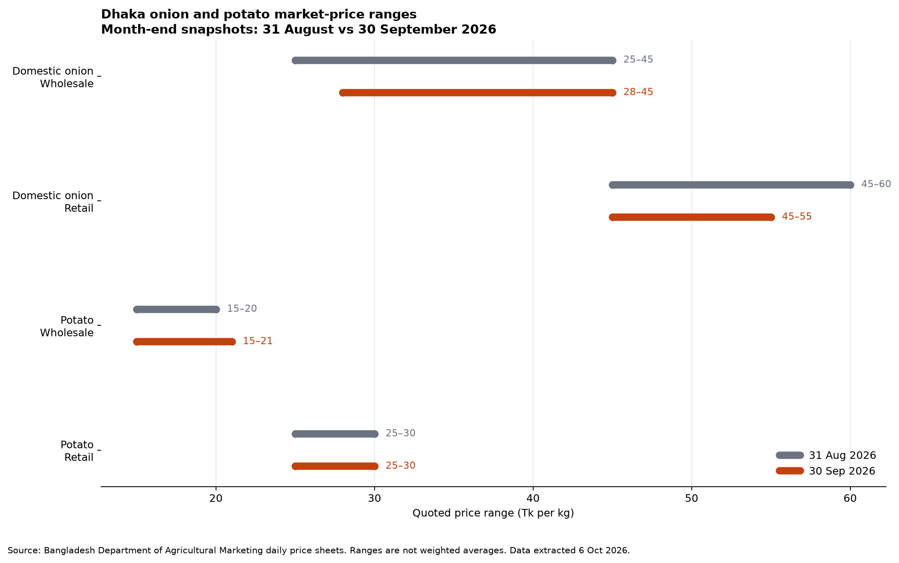

# Ministry of Agriculture — Monthly Data Watch

**Reporting period:** 2026-09  
**Research cutoff:** 6 October 2026 (UTC)  
**Coverage rule:** observation dates are separated from publication dates. Forecasts, approvals, administrative claims and journalism are not presented as observed September outcomes.

## Executive findings

1. **FACT — September market observations exist, but national monthly agriculture statistics do not.** The Department of Agricultural Marketing (DAM) posted daily Dhaka-market onion and potato sheets for 1–30 September. At month-end, quoted price ranges changed little from 31 August: domestic-onion wholesale moved from Tk25–45/kg to Tk28–45/kg; onion retail from Tk45–60 to Tk45–55; potato wholesale from Tk15–20 to Tk15–21; and potato retail remained Tk25–30.[1][2][3]
2. **FACT — most core official series were still one to three months behind.** BBS's latest visible CPI observation was August; IMED's latest ADP report covered July–August; and Bangladesh Bank's agriculture/rural-finance archive ended at June.[4][7][8]
   The separate rural-credit archive ended at July.[9]
   **No September BBS CPI, DAE district fertilizer-distribution return, Ministry production bulletin or September ministry-level IMED implementation table was located by the cutoff.**
3. **OFFICIAL CLAIM vs INDEPENDENT EVIDENCE — the fertilizer narrative is mixed.** The minister said there was no fertilizer shortage and stocks exceeded demand, while later multi-district reporting documented unavailable fertilizer at some dealer points, reported premiums of Tk300–350 per 50kg bag, and an official acknowledgement of localized distribution problems.[14][16] Aggregate national stock and local farmer access can both be true; the missing link is district-level stock, lifting and sale data.
4. **FACT — September's strongest production and food-security evidence is forecast-based.** FAO estimated 2026 Boro output at 31.9 million tonnes, Aus at 4.1 million tonnes, preliminarily forecast Aman at 25.9 million tonnes, and projected 18.1 million people in IPC Phase 3+ during September–December.[10] These are institutional estimates/projections, not final Ministry figures or observed September outcomes.
5. **INVESTIGATIVE ASSESSMENT — evidence is sufficient for a records-driven fertilizer-distribution story, but not for an allegation of corruption or a national shortage.** The testable question is whether depot stock and district allocations translated into timely dealer lifting and farmer sales during Aman.

## Dashboard

| Metric | Current | Previous month / period | YoY | Target / benchmark | Source |
|---|---:|---:|---:|---:|---|
| Domestic onion, wholesale, Dhaka | Tk28–45/kg on 30 Sep | Tk25–45/kg on 31 Aug | Not available | No official target | DAM daily sheets[2][3] |
| Domestic onion, retail, Dhaka | Tk45–55/kg on 30 Sep | Tk45–60/kg on 31 Aug | Not available | No official target | DAM daily sheets[2][3] |
| Potato, wholesale, Dhaka | Tk15–21/kg on 30 Sep | Tk15–20/kg on 31 Aug | Not available | No official target | DAM daily sheets[2][3] |
| Potato, retail, Dhaka | Tk25–30/kg on 30 Sep | Tk25–30/kg on 31 Aug | Not available | No official target | DAM daily sheets[2][3] |
| National CPI, point-to-point **(latest: Aug)** | 8.26% | 8.32% in Jul; **−0.06 percentage point** | 8.29% in Aug 2025; **−0.03 point** | BB FY2026-27 target not evaluated here | BBS/BB[4][6] |
| National food CPI **(latest: Aug)** | 7.02% | 7.16% in Jul; **−0.14 point** | Not extracted | No ministry target | BBS/BB[4][6] |
| National non-food CPI **(latest: Aug)** | 9.32% | 9.28% in Jul; **+0.04 point** | Not extracted | No ministry target | BBS/BB[4][6] |
| Government-wide ADP financial implementation | 1.85% through Jul–Aug FY2026-27 | Not extracted | Not extracted | Government-wide comparator only | IMED[7][24] |
| Aman production | 25.9m tonnes **forecast** | Not comparable | Not extracted | Preliminary forecast, not target | FAO[10] |
| People projected IPC Phase 3+ | 18.1m, Sep–Dec | 15.3m estimated for May–Aug | Not applicable | Lower is better; no ministry target | FAO[10] |

**CALCULATION NOTE:** CPI movements are expressed in percentage points, not percent changes, because percentage changes in an inflation rate can mislead. DAM changes compare range endpoints at two month-end snapshots; they are not changes in monthly average prices.

## What changed?

### 1. Dhaka onion and potato snapshots

DAM's 30 September sheet is an official observation for Dhaka metropolitan markets, quoted in Tk/kg.[2] The previous comparator is 31 August, not an August monthly average.[3]

| Commodity / level | 31 Aug | 30 Sep | CALCULATION — endpoint movement |
|---|---:|---:|---|
| Domestic onion wholesale | 25–45 | 28–45 | low +Tk3 (+12.0%); high unchanged |
| Domestic onion retail | 45–60 | 45–55 | low unchanged; high −Tk5 (−8.33%) |
| Potato wholesale | 15–20 | 15–21 | low unchanged; high +Tk1 (+5.0%) |
| Potato retail | 25–30 | 25–30 | unchanged |

**ANALYSIS:** None of these endpoint changes crosses a domain-relevant alarm threshold by itself. The narrow coverage—two commodities, Dhaka, quoted ranges—does not support a claim that national food prices were stable.

### 2. New September publications, but older observation periods

- Bangladesh Bank published a September-titled *Monthly Economic Trends*, but its CPI table ends in August.[6]
- IMED published its July–August FY2026-27 ADP progress report on 21 September; the government-wide financial implementation value was 1.85%.[7][24]
- FAO's 4 September country brief reaches the reporting period, but its Aman, aggregate paddy and food-security numbers are forecasts/projections.[10]

### 3. Data that did not arrive by the cutoff

No September observation was located in the checked BBS CPI page, Ministry/DAE production and fertilizer-distribution pages, Bangladesh Bank agriculture-finance series, or ministry-level IMED table.[4][7][8]

The separate rural-credit archive also had no September observation.[9]

This is a finding about the indexed official sources checked on 6 October, not proof that no unpublished or non-indexed record exists.

## Historical context

### Available comparisons

- **National point-to-point CPI:** 8.26% in August 2026 versus 8.32% in July 2026 and 8.29% in August 2025.[6]
- **Twelve-month-average CPI:** 8.66% in August 2026 versus 9.58% in August 2025.[6]
- **FAO production context:** 2026 Boro production was estimated at 31.9m tonnes, described as close to the previous year's record; aggregate 2026/27 paddy production was forecast at 61.9m tonnes, about 5% above the average.[10]

### Comparisons not defensibly available

A consistent 24-month series, rolling three-month average, Ministry-specific FYTD implementation comparison and 3–5-year DAM series were not constructed because the reviewed sources did not expose a consistent machine-readable series for the September indicators. The World Bank real-time food-price dataset covers 76 markets but ends on 1 May 2026 and uses modelled/imputed values; it cannot establish September conditions.[23]

## Government claims vs data

### Claim 1 — fertilizer availability

**CLAIM:** “There is no fertilizer shortage; stocks exceed demand.”  
**SOURCE:** Agriculture minister, reported by bdnews24 Bangla.  
**DATE:** 18 August 2026.[14]  
**MEASURABLE COMPONENT:** National and district stock, district allocation, dealer lifting, farmer sales, timeliness and prices.  
**OFFICIAL DATA:** No September DAE district stock/lifting/sales return was located. A government adviser later stated that aggregate fertilizer stock was 1.365m tonnes.[16]  
**INDEPENDENT EVIDENCE:** TBS reported unavailable fertilizer at designated dealer points in several districts and premiums of Tk300–350 per 50kg bag; it also reported the adviser acknowledging distribution problems in some areas.[16] Prothom Alo reported August allocation-to-distribution gaps, citing DAE returns, but the underlying returns were not obtained.[15]  
**VERDICT:** **Mixed.** Available evidence does not disprove aggregate national stock, but it is inconsistent with an unqualified claim of adequate farmer access everywhere. National stock is not the same metric as district- and time-specific availability.

### Claim 2 — nationwide market monitoring

**CLAIM:** DAM's price sheet says nationwide market-monitoring activity is ongoing.[2]  
**MEASURABLE COMPONENT:** Geographic coverage, commodity coverage, publication frequency and representativeness.  
**OFFICIAL DATA:** The numeric sheet reviewed covers Dhaka metropolitan-market onion and potato price ranges.[2]  
**INDEPENDENT EVIDENCE:** None located that validates national representativeness of this sheet.  
**VERDICT:** **Insufficient evidence.** The administrative monitoring claim may be true, but the published numeric table reviewed does not demonstrate nationwide coverage.

## Budget / project implementation

- **Government-wide ADP:** financial implementation was 1.85% through July–August FY2026-27.[24] The linked report was scanned and no reliable Ministry of Agriculture project-level allocation, expenditure, financial implementation or physical implementation value was extracted.[7]
- **Spending structure:** a World Bank assessment says fertilizer subsidies account for about 80% of the Ministry's budget; the top 20% of landholders receive about half of subsidy benefits and the bottom 40% about 15%.[11] This is a structural estimate, not September execution data.
- **Emergency financing:** the World Bank approved $300m to finance 600,000 tonnes of critical fertilizer for the 2026 Aman and Boro seasons.[12] The project page was active, but approval/status is not proof of contract award, shipment, customs clearance, depot receipt or farmer delivery.[13]
- **Procurement approvals:** on 19 August, CCGP approved 115,000 tonnes of MOP and urea imports—40,000 tonnes MOP from Canada, 35,000 tonnes MOP from Russia and 40,000 tonnes granular urea from Saudi Arabia—according to BSS.[18] These are approval-stage records, not September delivery evidence.
- **Dealer-policy transition:** the Ministry published an integrated fertilizer dealer appointment/distribution policy on 30 August.[19] The linked 32-page policy was image-only; this report does not infer its operative rules without verified text extraction.

**INVESTIGATIVE LEAD — requires further verification:** trace every approved fertilizer lot from CCGP decision to signed contract, letter of credit, bill of lading, customs release, BADC/BCIC depot receipt, district dispatch and farmer-facing sale.

## Independent reporting and external evidence

- FAO identified localized flood/landslide crop losses in Chattogram, Cox's Bazar, Moulvibazar and Habiganj and said most affected areas were subsequently replanted.[10]
- FAO projected 18.1m people in IPC Phase 3+ for September–December, including about 787,000 in Phase 4.[10]
- TBS's multi-district reporting found a mixed picture: adequate stocks in some places, but unavailable fertilizer or above-fixed prices in others.[16]
- A separate TBS analysis, citing DAE and Ministry data, reported projected FY2026-27 fertilizer demand of 6.77m tonnes, stock just above 1.6m tonnes, and FY2025-26 state-plant output of 1.106m tonnes against roughly 6.6m tonnes of demand.[17] These administrative figures remain attributed journalism until the underlying records are obtained.
- BIGD's publication on a 2025 BIDS–BIGD–SANEM rapid study identified high input costs, structural inefficiency, intermediary dependence and urban-wholesaler power as drivers of earlier food-price pressure.[20] This is context, not September measurement.
- ADB's July outlook and CPD's September pulse provide macroeconomic context but not a September Ministry of Agriculture outcome; CPD's inflation presentation uses moving averages and must not be confused with BBS point-to-point CPI.[21][22]

## Geographic or demographic disparities

1. **Rural–urban inflation:** latest official August headline inflation was 8.31% rural and 8.20% urban.[5] This 0.11-point difference is small and does not identify agricultural households specifically.
2. **Flood-affected districts:** FAO named Chattogram, Cox's Bazar, Moulvibazar and Habiganj as locations of localized 2026 crop losses.[10]
3. **Displaced populations:** FAO projected 35% of approximately 1.2m forcibly displaced Myanmar nationals in Cox's Bazar and Bhasan Char to face IPC Phase 3+, including 10% in Phase 4.[10]
4. **Fertilizer access:** reporting identified problems in selected districts, but no complete district-by-district September administrative dataset was available.[15][16] No national prevalence rate should be inferred from those reports.

## Anomalies

### A1. DAM catalogue label does not match its contents

- **Number:** 63 dated entries were listed through 5 October; September dates 1–30 were present.[1]
- **Baseline:** a monthly-report page would normally identify the month represented by its table.
- **Why unusual:** the table heading remains “আগষ্ট-২০২৬” while listing September and October entries, and the displayed publication date remains 29 July.[1]
- **Possible benign explanations:** a continuously updated page reused without changing its title or publication metadata.
- **Evidence still needed:** DAM content-management audit log and formal release timestamps.

### A2. BBS publication timestamp conflicts with the observation period

- **Number:** August CPI is 8.26%, but the page displays publication date 11 August and a last-update timestamp of 7 September.[4]
- **Baseline:** a completed monthly statistic normally cannot be published before the observation month ends.
- **Why unusual:** the displayed publication date is chronologically inconsistent if interpreted literally.
- **Possible benign explanations:** template metadata, date-entry error or recycled page record.
- **Evidence still needed:** BBS release calendar, original press release and revision log.

### A3. National fertilizer stock claim versus reported local access failures

- **Number:** claimed national stock 1.365m tonnes; reported open-market premium Tk300–350 per 50kg bag in selected locations.[16]
- **Baseline:** adequate aggregate stock should ordinarily be reflected in timely authorized-dealer availability at fixed prices.
- **Why unusual:** simultaneous national adequacy and local scarcity suggest a distribution, allocation, lifting, timing or enforcement problem.
- **Possible benign explanations:** product-specific demand, seasonal timing, transport delay, uneven district allocation, dealers lifting late, panic buying or short-lived localized shocks.
- **Evidence still needed:** district opening stock, allocation, depot dispatch, dealer lifting, daily sales, inspections, penalties and farmer invoices.

### A4. Agriculture-credit publication lag

- **Number:** at the 6 October cutoff, Bangladesh Bank's latest listed agriculture/rural-finance report was June and rural-credit position was July.[8][9]
- **Baseline:** a monthly accountability watch requires data close enough to the reporting month to detect change.
- **Why unusual:** the lag prevents assessment of August–September rural-credit conditions.
- **Possible benign explanations:** routine compilation and validation delay.
- **Evidence still needed:** statutory release timetable, delayed-publication notice and underlying provisional series.

### A5. Large emergency fertilizer project with no visible delivery result in the reviewed page

- **Number:** $300m financing; 600,000-tonne target for Aman/Boro.[12]
- **Baseline:** an active emergency project tied to a current planting season should permit timely procurement and delivery tracking.
- **Why unusual:** the reviewed project page showed status but no usable results-framework or detailed financial-activity values.[13]
- **Possible benign explanations:** normal lag between approval, effectiveness, procurement and public dashboard updates.
- **Evidence still needed:** procurement plan, contract awards, disbursement ledger, implementation-status report, shipping documents and warehouse receipts.

None of these anomalies is proof of corruption or data falsification.

## Five investigative leads

Scores: 1 = low, 5 = high. “Further work” scores workload, so 5 means substantial additional work.

| Rank | Investigative lead | Evidence strength | Public importance | Novelty | Visual potential | Further work | Assessment |
|---:|---|---:|---:|---:|---:|---:|---|
| 1 | Stock on paper vs fertilizer at the farm gate | 5 | 5 | 5 | 5 | 4 | **Story-ready as a records investigation**, not as a proven national shortage |
| 2 | Track each approved fertilizer lot from CCGP to district delivery | 4 | 5 | 4 | 5 | 5 | Strong document trail; delivery evidence still missing |
| 3 | Audit who receives fertilizer subsidies | 4 | 5 | 4 | 4 | 5 | Strong inequality baseline; beneficiary-level records needed |
| 4 | Map flood losses, replanting and food insecurity | 4 | 5 | 4 | 5 | 4 | Clear districts and populations; local verification required |
| 5 | Test emergency-project execution transparency | 4 | 5 | 4 | 3 | 5 | High-value transparency question; no evidence yet of implementation failure |

### Lead 1 — stock on paper vs access

**Hypothesis to test:** district allocation, dealer lifting and farmer sales diverged during Aman.  
**Minimum proof package:** monthly district allocation orders, opening/closing depot stock, dealer lifting, farmer sales registers, inspection records and price-board/invoice evidence.  
**Do not claim yet:** nationwide shortage, hoarding conspiracy or official misconduct.

### Lead 2 — procurement-to-delivery tracker

**Hypothesis to test:** some approved consignments may not have reached districts within the intended seasonal window.  
**Minimum proof package:** CCGP minutes, contracts, LC dates, bills of lading, customs entries, quality certificates, depot receipts and district dispatches.

### Lead 3 — subsidy incidence

**Hypothesis to test:** landholding size and dealer access shape who captures fertilizer subsidy benefits.  
**Minimum proof package:** anonymized farmer-card/e-voucher data, landholding class, tenant status, sex of operator, district and product quantities.

### Lead 4 — flood and food-security map

**Hypothesis to test:** the four FAO-named districts experienced weaker crop recovery, input access or market outcomes than national production forecasts imply.  
**Minimum proof package:** crop-cutting estimates, replanting records, satellite/flood layers, local DAM prices and farmer interviews.

### Lead 5 — emergency-project transparency

**Hypothesis to test:** public project reporting lags behind the seasonal urgency of procurement and delivery.  
**Minimum proof package:** World Bank procurement plan, disbursements, implementation reports and implementing-agency shipment/delivery records.

## Suggested YouTube angles

### 1. TITLE
**“Bangladesh Has Fertilizer—So Why Couldn't Farmers Buy It?”**

**ONE-SENTENCE THESIS:** Aggregate national stock can coexist with local shortages when allocation, dealer lifting and last-mile delivery fail.  
**KEY DATA:** claimed 1.365m-tonne stock; reported Tk300–350 premium per 50kg bag; district allocation/distribution reports still need primary verification.[15][16]  
**VISUAL:** animated chain from port → depot → district → dealer → farmer, with red gaps where documents are missing.  
**COUNTERARGUMENT:** the problem may have been brief, localized and driven by panic or product-specific demand rather than a national supply failure.  
**DOCUMENTS REQUIRED:** DAE district returns, dealer lifting logs, farmer sale registers, inspection files and invoices.

### 2. TITLE
**“115,000 Tonnes Approved: Did the Fertilizer Reach the Fields?”**

**ONE-SENTENCE THESIS:** procurement approval is only the first step; accountability requires tracking each lot to seasonal delivery.  
**KEY DATA:** 115,000 tonnes approved on 19 August across Canadian, Russian and Saudi suppliers.[18]  
**VISUAL:** shipment tracker with approval, contract, port, customs, depot and district milestones.  
**COUNTERARGUMENT:** normal international procurement lead times may extend beyond September without implying failure.  
**DOCUMENTS REQUIRED:** CCGP minutes, contracts, LC, bill of lading, customs release, quality test and warehouse receipts.

### 3. TITLE
**“The $300 Million Fertilizer Emergency Project: Approval vs Delivery”**

**ONE-SENTENCE THESIS:** a current-season emergency project should be judged by fertilizer delivered, not financing announced.  
**KEY DATA:** $300m financing and 600,000-tonne project target.[12]  
**VISUAL:** target gauge beside verified contract, shipment and delivery totals.  
**COUNTERARGUMENT:** project activation and reporting can legitimately lag approval.  
**DOCUMENTS REQUIRED:** procurement plan, disbursements, ISR/implementation reports and implementing-agency records.

### 4. TITLE
**“80% of the Agriculture Budget Goes to Fertilizer Subsidy—Who Benefits?”**

**ONE-SENTENCE THESIS:** fertilizer support stabilizes production, but benefits may be concentrated among larger landholders.  
**KEY DATA:** about 80% of the Ministry budget; top 20% of landholders receive about half of benefits; bottom 40% receive about 15%.[11]  
**VISUAL:** landholding-decile subsidy distribution and map of dealer access.  
**COUNTERARGUMENT:** larger farms purchase more fertilizer because they cultivate more land; incidence should also be assessed per acre and by production contribution.  
**DOCUMENTS REQUIRED:** subsidy accounts, purchase quantities, landholding classes, farmer-card/e-voucher records and per-acre analysis.

### 5. TITLE
**“A Good Harvest Forecast, 18.1 Million People in Crisis: The Bangladesh Food Paradox”**

**ONE-SENTENCE THESIS:** national production forecasts can improve while purchasing-power and localized climate shocks leave millions food-insecure.  
**KEY DATA:** forecast 61.9m tonnes aggregate paddy; projected 18.1m people in IPC Phase 3+.[10]  
**VISUAL:** national production line overlaid with IPC population and maps of flood-affected districts.  
**COUNTERARGUMENT:** the IPC number is a projection and includes drivers beyond domestic crop volume.  
**DOCUMENTS REQUIRED:** IPC analytical annex, district crop-loss/replanting data, wage series, food-assistance coverage and local prices.

## Source publication dates and evidence type

| ID | Publication / reference date | Evidence type |
|---:|---|---|
| 1–3 | Index published 29 Jul; updated 5 Oct; sheets dated 31 Aug and 30 Sep | Official DAM daily observations and index |
| 4–5 | Displayed 11 Aug; pages updated 7 Sep | Official BBS August observations; timestamp anomaly |
| 6 | September 2026 issue; formal date not stated | Official BB publication; observations through August |
| 7, 24 | 21 Sep / homepage current at cutoff | Official IMED July–August progress |
| 8–9 | Dates not stated on archive indexes | Official BB archive status |
| 10 | 4 Sep 2026 reference date | FAO estimates and projections |
| 11 | 15 Jun 2026 | World Bank structural evidence |
| 12–13 | 26 Jun 2026 approval; project page checked 1 Oct | World Bank financing/project status |
| 14 | 18 Aug 2026 | Journalism recording ministerial claim |
| 15 | 25 Aug 2026 | Journalism citing DAE figures |
| 16–17 | 26 Aug 2026 | Independent field/investigative reporting |
| 18 | 19 Aug 2026 | State-media report of CCGP approval |
| 19 | 30 Aug 2026 | Official Ministry policy page |
| 20 | 19 Jan 2026 | Independent research context |
| 21 | Jul 2026 | ADB forecast/context |
| 22 | Sep 2026 | CPD analytical compilation |
| 23 | 18 May 2026 version; data to 1 May | World Bank modelled market-price dataset |

## Data quality note

- **Unavailable:** September BBS CPI; September Ministry/DAE production bulletin; September district fertilizer stock/allocation/lifting/sales return; Ministry-specific September IMED implementation; verified agriculture-specific BPPA/e-GP award anomalies; current CAG finding; 24-month DAM machine-readable series.
- **Delayed:** Bangladesh Bank agricultural/rural-finance archive ended at June and rural-credit archive at July as of 6 October.[8][9]
- **Methodological limits:** DAM values are Dhaka quoted ranges, not national averages. FAO output and IPC numbers include estimates/forecasts. Journalism documents reported experiences but is not a representative survey.
- **Provisional values:** FAO's Aman and aggregate paddy figures are forecasts; IPC values are projections.[10]
- **Discrepancies:** DAM's table heading and publication metadata do not match listed dates; BBS's displayed publication date conflicts with its observation period and update timestamp.[1][4]
- **OCR:** no OCR-derived statistic is used. The scanned IMED and Ministry policy attachments were not interpreted beyond their verified landing-page metadata.
- **Calculation coverage:** no YoY, FYTD, rolling three-month, rolling 12-month or 3–5-year statistic was manufactured where a consistent denominator or source series was unavailable.

## Files

- Structured data: `../data/2026-09.csv`
- Source manifest: `../sources/2026-09.json`
- Citation ledger: `../sources/2026-09.ledger.json`
- Figure PNG: `../figures/2026-09/market_price_snapshot.png`
- Figure CSV: `../figures/2026-09/market_price_snapshot.csv`
- Figure script: `../figures/2026-09/plot_market_price_snapshot.py`

## Sources

[1] https://dam.gov.bd/pages/monthly-reports/wholesale-and-retail-market-prices-of-onions-and-potatoes-zeq0oi-6a69c79926a072a44ede0379 — পেঁয়াজ ও আলুর পাইকারী ও খুচরা বাজারদর
[2] https://objectstorage.ap-dcc-gazipur-1.oraclecloud15.com/n/axvjbnqprylg/b/V2Ministry/o/office-dam/2026/8/b60dccf8-19a5-4573-89a8-eba1c4e5ab93.pdf — Dhaka onion and potato wholesale/retail market prices — 30 September 2026
[3] https://objectstorage.ap-dcc-gazipur-1.oraclecloud15.com/n/axvjbnqprylg/b/V2Ministry/o/office-dam/2026/7/0701b54b-acc4-40dc-aa1c-8cb1555b3587.pdf — Dhaka onion and potato wholesale/retail market prices — 31 August 2026
[4] https://bbs.gov.bd/pages/news/inflation-871-march-2026-food-national-824-march-2026-non-food-national-909-march-2026-z9yjkc-69d22feef7ec7f3c3f62fa07 — Inflation: 8.26% (August 2026); Food 7.02%; Non-food 9.32%
[5] https://bbs.gov.bd/pages/news/rural-inflation-872-march-2026-urban-inflation-868-march-2026-db6lis-69d230069d736d71f1a3b8d1 — Rural inflation 8.31% and urban inflation 8.20% — August 2026
[6] https://www.bb.org.bd/pub/monthly/econtrds/etsep26.pdf — Monthly Economic Trends — September 2026
[7] https://imed.gov.bd/pages/reports/6ab11075390327d37a286ac3 — জুলাই-আগস্ট'২০২৬ পর্যন্ত এডিপি বাস্তবায়ন অগ্রগতি
[8] https://www.bb.org.bd/en/index.php/publication/publictn/3/56 — Monthly Report on Agricultural and Rural Financing archive
[9] https://www.bb.org.bd/en/index.php/publication/publictn/3/96 — Agricultural and Non-Farm Rural Credit Position archive
[10] https://www.fao.org/giews/countrybrief/country.jsp?code=BGD&form=MG0AV3 — Country Brief: Bangladesh
[11] https://www.worldbank.org/en/news/press-release/2026/06/15/smarter-agricultural-public-spending-is-key-to-jobs-productivity-and-resilience-in-bangladesh — Smarter Agricultural Public Spending is Key to Jobs, Productivity and Resilience in Bangladesh
[12] https://www.worldbank.org/en/news/press-release/2026/06/26/bangladesh-world-bank-provides-1-1-billion-emergency-support-to-safeguard-food-security-livelihoods — Bangladesh: World Bank Provides $1.1 Billion Emergency Support to Safeguard Food Security, Livelihoods
[13] https://projects.worldbank.org/en/projects-operations/project-detail/P517487 — Emergency Support for Food Security — P517487
[14] https://bangla.bdnews24.com/economy/cfc83897f2c8 — সারের সংকট নেই, বরং চাহিদার অতিরিক্ত মজুত আছে: কৃষিমন্ত্রী
[15] https://www.prothomalo.com/bangladesh/mtdnwu1uac — সরকারের গুদামে সার আছে, সমস্যা বিতরণে
[16] https://www.tbsnews.net/bangladesh/farmers-face-fertiliser-squeeze-amid-distribution-failures-1525141 — Farmers face fertiliser squeeze amid distribution failures
[17] https://www.tbsnews.net/features/panorama/fertiliser-shortage-first-phase-looming-crisis-1525391 — Fertiliser shortage: First phase of a looming crisis?
[18] https://www.bssnews.net/news-flash/416224 — CCGP approves LNG, fertiliser imports proposals
[19] https://moa.gov.bd/pages/policies/%E0%A6%B8%E0%A6%BE%E0%A6%B0-%E0%A6%A1%E0%A6%BF%E0%A6%B2%E0%A6%BE%E0%A6%B0-%E0%A6%A8%E0%A6%BF%E0%A7%9F%E0%A7%8B%E0%A6%97-%E0%A6%93-%E0%A6%B8%E0%A6%BE%E0%A6%B0-%E0%A6%AC%E0%A6%BF%E0%A6%A4%E0%A6%B0%E0%A6%A3-%E0%A6%B8%E0%A6%82%E0%A6%95%E0%A7%8D%E0%A6%B0%E0%A6%BE%E0%A6%A8%E0%A7%8D%E0%A6%A4-%E0%A6%B8%E0%A6%AE%E0%A6%A8%E0%A7%8D%E0%A6%AC%E0%A6%BF%E0%A6%A4-%E0%A6%A8%E0%A7%80%E0%A6%A4%E0%A6%BF%E0%A6%AE%E0%A6%BE%E0%A6%B2%E0%A6%BE-%E0%A7%A8%E0%A7%A6%E0%A7%A8%E0%A7%AC-%E0%A6%AC%E0%A6%BE%E0%A6%B8%E0%A7%8D%E0%A6%A4%E0%A6%AC%E0%A6%BE%E0%A7%9F%E0%A6%A8-6r6rvr-6a942df4ee91f75135ebfbc3 — সার ডিলার নিয়োগ ও সার বিতরণ সংক্রান্ত সমন্বিত নীতিমালা ২০২৬ বাস্তবায়ন
[20] https://bigd.bracu.ac.bd/publications/food-price-hikes-in-bangladesh-causes-and-consequences — Food Price Hikes in Bangladesh: Causes and Consequences
[21] https://www.adb.org/outlook/editions/july-2026 — Asian Development Outlook — July 2026
[22] https://cpd.org.bd/publication/bangladesh-macroeconomic-pulse-volume-2-issue-1 — Bangladesh Macroeconomic Pulse — Volume 2, Issue 1
[23] https://microdata.worldbank.org/index.php/catalog/6164/study-description — Bangladesh Real Time Food Prices
[24] https://imed.gov.bd — IMED homepage — FY2026-27 ADP financial progress
